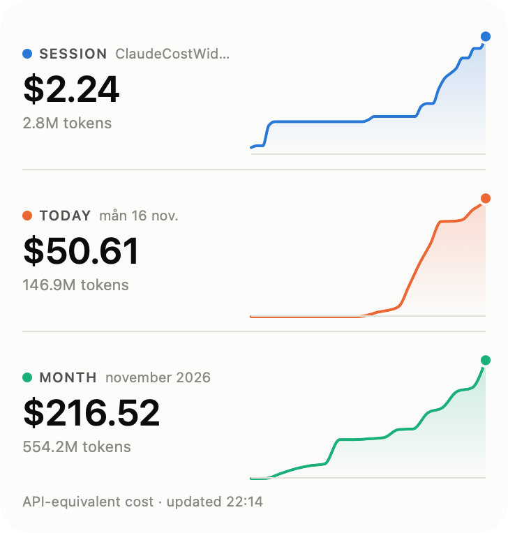
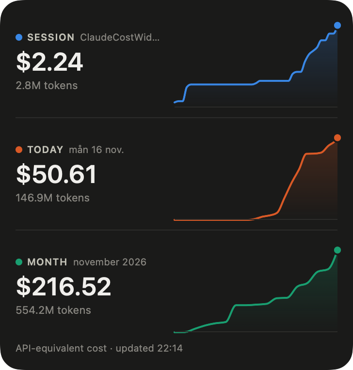
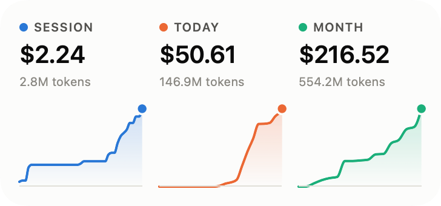
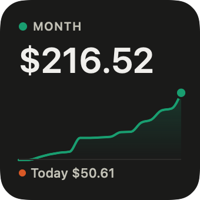

<h1 align="center">ClaudeCost</h1>

<p align="center">
  A desktop widget that shows what your Claude Code usage would cost on the API.<br>
  Session, today and this month at a glance, each with its own live line chart.
</p>

<p align="center">
  
  
</p>

## Features

- **Three periods** – the current session (blue), today (orange) and this month (green), each with cost, tokens and a cumulative line chart.
- **Live** – new log lines are picked up every 15 seconds. Only new bytes are read, so a refresh takes milliseconds.
- **Three widget sizes** – small (month + today), medium (three columns) and large (three rows).
- **Menu bar** – the month's cost sits in the menu bar. Click it for the full dashboard.
- **New session in one click** – clicking the widget opens Terminal and starts `claude` in `~/Desktop/Projects`.
- **Local only** – reads Claude Code's own logs in `~/.claude/projects`. No API key, no network.
- **Light and dark mode** – follows the system.

<p align="center">
  
  
</p>

## Install

Requires **Xcode** (the widget extension can't be built with the Command Line Tools alone) and an Apple ID signed in under **Xcode → Settings → Accounts**.

```sh
git clone https://github.com/Zapeman02/ClaudeCost.git
cd ClaudeCost
./build.sh install
```

This builds the app, copies it to `/Applications` and launches it.

Then add the widget: right-click the desktop → **Edit Widgets…** → search for **Claude Cost**.

## Usage

| Do this | What happens |
| --- | --- |
| Click the widget | Opens Terminal with a new `claude` session in `~/Desktop/Projects` |
| Click the cost in the menu bar | Opens the dashboard |
| **New session** in the dashboard | Same as clicking the widget |
| **Quit** in the dashboard (⌘Q) | Quits the app |

## Good to know

- **API-equivalent cost.** The numbers are what the tokens would cost at API prices, including cache reads and writes and fast mode. On a Pro or Max plan you don't pay this. It shows how much you get out of the subscription.
- **Claude Code only.** Chats on claude.ai aren't stored locally, so they don't show up.
- **Session** is the most recently active Claude Code session, including its subagents.
- **Keep the app running.** The app reads the logs and the widget only displays what it saved. When the app isn't running the widget shows the last numbers.
- **Widget refresh.** macOS limits how often widgets reload, so the widget can lag the menu bar a little. It reloads at most every 30 seconds, and only when a number changed.
- **Prices** live in `Shared/Pricing.swift`. Update them there when Anthropic changes its pricing.
- **macOS 14 Sonoma or later.**

## Uninstall

Quit the app, remove the widget, then delete `/Applications/ClaudeCost.app`.

## Development

```sh
./check.sh      # unit tests + full build
swift test      # unit tests only
./build.sh      # build only
```

| Folder | Contains |
| --- | --- |
| `Shared/` | Log parsing, pricing, summaries and the SwiftUI views. Used by both targets and by `swift test` |
| `App/` | Menu bar app: scans the logs, saves the summary, opens new sessions |
| `Widget/` | The WidgetKit extension |
| `Tests/` | Unit tests for the shared core |

## License

[MIT](LICENSE) © Kasper Back. Free to use, modify and share. Just keep the copyright notice.
